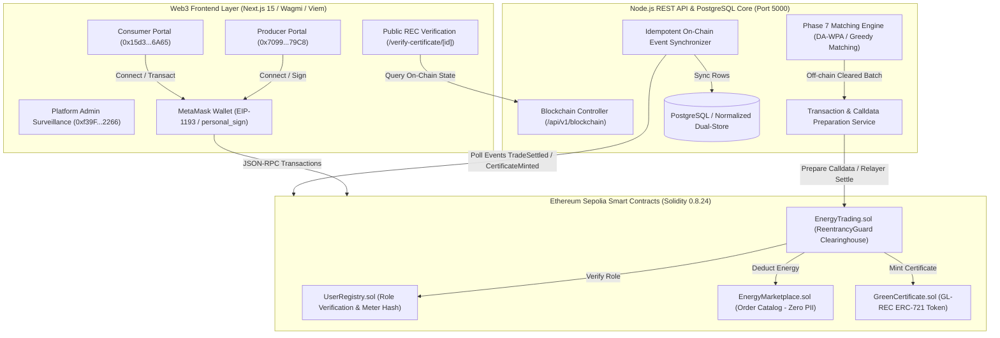
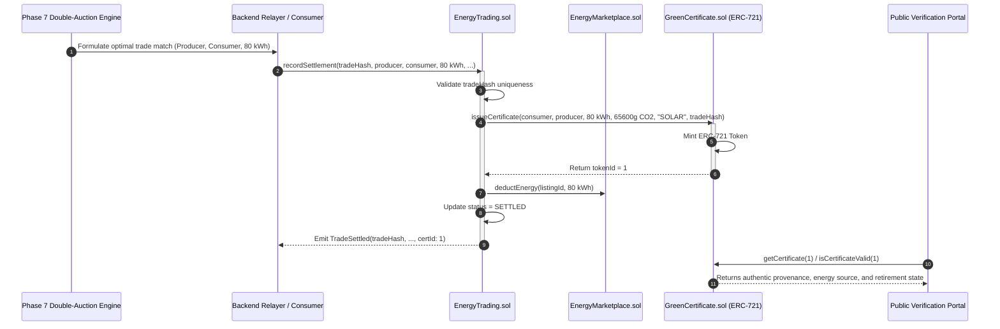

# GreenLedger Blockchain Architecture & Ethereum Sepolia Integration

## 1. Executive Summary

**GreenLedger** implements an off-chain compute, on-chain verification hybrid architecture for decentralized peer-to-peer (P2P) renewable energy trading. 

- **Off-Chain Engine:** Continuous physical telemetry sampling, demand-aware weighted proportional allocation (DA-WPA), price-aware greedy merit-order double-auction clearing, and time-of-use dynamic pricing executed in Node.js/PostgreSQL.
- **On-Chain Settlement Layer:** Deployed on **Ethereum Sepolia Testnet** (Chain ID: `11155111`) using Solidity `^0.8.24` and OpenZeppelin v5.2.0. The smart contract suite cryptographically anchors trade agreements, executes financial clearing, enforces non-reentrant state transitions, prevents duplicate settlements, and mints verified ERC-721 Renewable Energy Certificates (**GL-REC**).

> [!IMPORTANT]
> **Network Boundary:** GreenLedger exclusively targets the **Ethereum Sepolia Testnet** (`11155111`) and local Hardhat developer networks (`31337`). **Mainnet deployment is strictly restricted.**

---

## 2. System Architecture & Component Interaction



---

## 3. Smart Contract Specifications

### 3.1. `UserRegistry.sol`
* **Address (Local / Reference):** `0x5FbDB2315678afecb367f032d93F642f64180aa3`
* **Standard:** Custom Identity & Access Registry (OpenZeppelin `Ownable`)
* **Role Enums:** `NONE (0)`, `PRODUCER (1)`, `CONSUMER (2)`, `ADMIN (3)`
* **Key Invariants:**
  - Prevents duplicate account registration per wallet address.
  - Links physical/simulated smart meter hardware hashes (`meterIdHash`) without storing any off-chain Personal Identifiable Information (PII) such as legal names, physical addresses, or email credentials.
  - Requires administrative verification before accounts become eligible for order placement or market listing creation.

### 3.2. `EnergyMarketplace.sol`
* **Address (Local / Reference):** `0xe7f1725E7734CE288F8367e1Bb143E90bb3F0512`
* **Standard:** Decentralized Renewable Catalog
* **Key Invariants:**
  - Only active, verified producers validated through `UserRegistry` can create offerings.
  - Represents offer parameters: Producer address, total capacity (kWh), available capacity (kWh), price per unit (Wei/kWh), energy source tag (`SOLAR`, `WIND`, `HYDRO`, `BIOMASS`).
  - Implements atomic capacity deduction via authorized `EnergyTrading` contract when matching proposals are finalized.

### 3.3. `EnergyTrading.sol`
* **Address (Local / Reference):** `0xCf7Ed3AccA5a467e9e704C703E8D87F634fB0Fc9`
* **Standard:** Financial Settlement & Trade Registry (OpenZeppelin `Ownable`, `ReentrancyGuard`)
* **Key Invariants:**
  - **Reentrancy Protection:** All financial state changes and native currency transfers utilize OpenZeppelin `nonReentrant` modifier.
  - **Double-Settlement Guard:** Each settlement relies on an immutable `bytes32 tradeHash`. Once status transitions to `SETTLED`, subsequent calls with the same trade hash are strictly rejected with `"EnergyTrading: trade already settled"`.
  - **Multi-Party Confirmation:** Supports bilateral trade lifecycle: `createTradeProposal(...)` $\rightarrow$ `confirmTrade(...)` by buyer/seller $\rightarrow$ `settleTrade(...)` or direct on-chain Sepolia ETH clearing (`settleTradeDirect(...)`).

### 3.4. `GreenCertificate.sol`
* **Address (Local / Reference):** `0x9fE46736679d2D9a65F0992F2272dE9f3c7fa6e0`
* **Standard:** ERC-721 URIStorage (`GL-REC`)
* **Key Invariants:**
  - Only authorized issuers (`EnergyTrading`) can execute `issueCertificate(...)`.
  - **Strict Double-Issuance Prevention:** Maintains `mapping(bytes32 => uint256) public tradeHashToTokenId`. Re-minting for an existing trade hash reverts with `"GreenCertificate: certificate already issued for trade"`.
  - **Retirement Mechanism:** The token owner can retire the certificate to permanently claim environmental carbon offsets, preventing secondary double-counting.
  - **Embedded Legal Disclaimer:** Emits and exposes the non-financial disclaimer constant.

---

## 4. Renewable Energy Certificate (GL-REC) Lifecycle



### 4.1. Environmental Attribute Mathematics
Carbon avoidance is calculated using regional baseline grid emission factors:

$$\Delta C = E \times \mathrm{EF}_{\text{grid}}$$

Where:
* $E$: Clean energy quantity ($80.0\text{ kWh}$)
* $\mathrm{EF}_{\text{grid}}$: Regional baseline grid emission factor ($0.82\text{ kg CO}_2/\text{kWh}$, Central Electricity Authority standard)
* $\Delta C$: Total avoided emissions ($65.60\text{ kg CO}_2 = 65,600\text{ grams CO}_2$)

---

## 5. Non-Financial Legal Disclaimer

> [!CAUTION]
> **Statutory Disclaimer:** GreenLedger Renewable Energy Certificates (GL-REC) are non-financial environmental attribute tracking tokens for carbon accounting verification only. They do not constitute financial securities, investments, or yield-generating instruments.

---

## 6. Hardhat Compilation, Testing & Deployment Commands

### 6.1. Smart Contract Compilation
```bash
# From repository root
cd blockchain
npx hardhat compile
```

### 6.2. Smart Contract Unit Test Suite (20 Passing Tests)
```bash
npx hardhat test
```
* **Coverage:** Role verification, duplicate user prevention, unauthorized listing rejection, GL-REC uniqueness enforcement, reentrancy resistance, double-settlement guards, and excess payment refunds.

### 6.3. Contract Deployment to Local Hardhat Network
```bash
npx hardhat run scripts/deploy.js --network localhost
```

### 6.4. Contract Deployment to Ethereum Sepolia Testnet
```bash
npx hardhat run scripts/deploy.js --network sepolia
```

Deployment manifests and full contract ABIs are automatically exported to:
- Frontend: `frontend/contracts/deployedContracts.json` & `frontend/contracts/index.ts`
- Backend: `backend/src/blockchain/deployedContracts.json`

---

## 7. Backend REST API Endpoints (Phase 9)

| Method | Endpoint | Description | Auth Required |
|---|---|---|---|
| `GET` | `/api/v1/blockchain/network` | Retrieves Sepolia chain status, gas price, block number | No |
| `GET` | `/api/v1/blockchain/contracts` | Returns manifest of all 4 deployed contracts & Etherscan links | No |
| `GET` | `/api/v1/blockchain/certificates` | Lists all issued GL-REC certificates | No |
| `GET` | `/api/v1/blockchain/certificates/:id/verify` | Public on-chain verification endpoint with cryptographic proof | No |
| `GET` | `/api/v1/blockchain/transactions/:id` | Detailed transaction receipt by hash or ID | No |
| `POST` | `/api/v1/blockchain/trades/:id/prepare` | Prepares contract calldata & parameters for MetaMask execution | Yes |
| `POST` | `/api/v1/blockchain/trades/:id/confirm` | Confirms on-chain trade settlement & records tx hash | Yes |
| `POST` | `/api/v1/blockchain/sync` | Triggers idempotent event listener sync into PostgreSQL | Yes |
