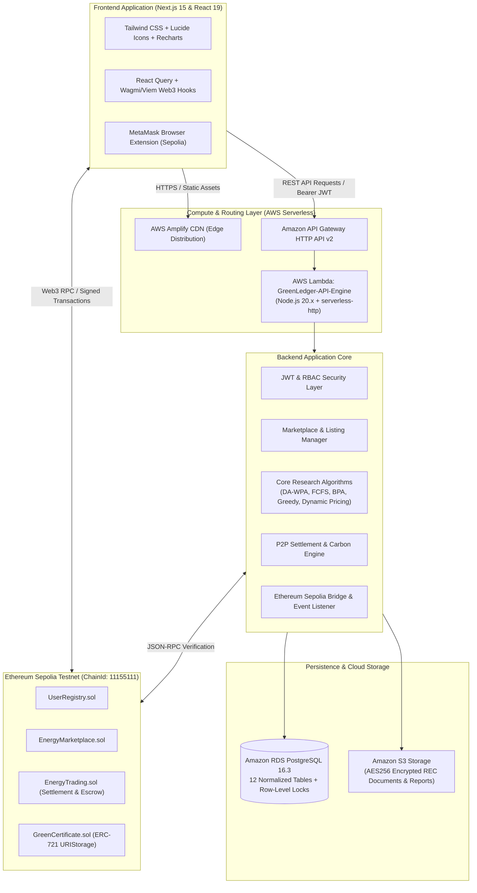
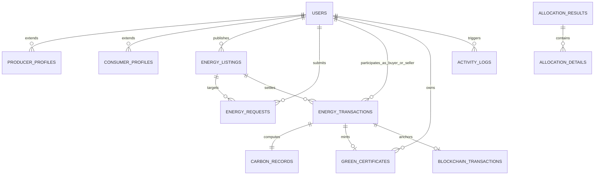

# GreenLedger – System Architecture Specification
**Phase 11 Comprehensive Architectural Document**  
**Project:** GreenLedger – Decentralized P2P Renewable Energy Trading Platform with Fairness-Aware Allocation  
**Author:** GreenLedger Engineering Team  
**Date:** November 2026  

---

## 1. System Overview

GreenLedger is a full-stack, enterprise-grade decentralized peer-to-peer (P2P) renewable energy trading platform designed for local microgrids and energy communities. The platform unifies **algorithmic fairness, dynamic pricing, off-chain order settlement, and on-chain blockchain immutability**.

---

## 2. Technology Stack Summary

| Layer | Technologies & Frameworks | Rationale & Specifications |
| :--- | :--- | :--- |
| **Frontend Framework** | **Next.js 15.1.7 (App Router)** + **React 19** | Server-side static generation (SSG) with client hydration, SEO, and fast time-to-interactive. |
| **Styling & Icons** | **Tailwind CSS 3.4** + **Lucide React** | Consistent fintech-grade design system with emerald/cyan renewable energy palette. |
| **Data Visualization** | **Recharts 2.15** | Interactive responsive charts for energy generation, consumption, tariffs, and fairness trends. |
| **Web3 & Wallet** | **Wagmi 2.14** + **Viem 2.23** | Clean, typed Web3 wallet integration with MetaMask, EIP-1193 provider handling, and Sepolia RPC. |
| **Backend Runtime** | **Node.js 20.x / 24.x** + **Express.js 4.21** | Lightweight, high-throughput asynchronous event loop for concurrent microgrid requests. |
| **Database** | **PostgreSQL 16.3** (`pg` connection pool) | ACID compliance, row-level locking for inventory integrity, foreign keys, and analytical queries. |
| **Research Algorithms** | **Deterministic JavaScript Algorithms** | Custom-implemented DA-WPA, FCFS, BPA, Greedy Double-Auction, and dynamic pricing models. |
| **Smart Contracts** | **Solidity ^0.8.20** + **Hardhat 2.22** | OpenZeppelin security contracts (`ReentrancyGuard`, `Ownable`, `ERC721URIStorage`). |
| **Cloud Hosting** | **AWS (Amplify, Lambda, API GW, RDS, S3)** | Highly available, cost-effective hybrid deployment with \$25/mo budget cap. |

---

## 3. Relational Database Architecture (PostgreSQL)

The database schema is structured into 12 normalized relational tables with comprehensive indexing and foreign key constraints:

### Table Definitions & Enforced Constraints
1. **`users`**: Stores user identities, roles (`ADMIN`, `PRODUCER`, `CONSUMER`), bcrypt password hashes, meter IDs, wallet addresses, and reputation scores.
2. **`energy_listings`**: Active, filled, or cancelled renewable energy offerings with source types, quantities, unit prices, and time windows.
3. **`energy_requests`**: Consumer demand orders with priority weights ($1.0\times - 2.0\times$), max acceptable prices, and urgency levels.
4. **`energy_transactions`**: Finalized trade settlements linking buyer, seller, quantity, price, and blockchain transaction hash.
5. **`carbon_records`**: Verified environmental impact records calculated via regional grid emission factors ($0.82\text{ kg CO}_2/\text{kWh}$).
6. **`green_certificates`**: Digital Renewable Energy Certificates (GL-REC) referencing on-chain ERC-721 token IDs.
7. **`allocation_results` & `allocation_details`**: Mathematical logs of executed allocation algorithms, Jain's fairness scores, and per-consumer fulfilled ratios.
8. **`pricing_history`**: Time-series log of dynamic pricing clearing ratios, baseline tariffs, and time-of-use multipliers.
9. **`blockchain_transactions`**: On-chain audit trail recording mined blocks, transaction hashes, and smart contract addresses.
10. **`platform_settings`**: Configurable system constants, base tariffs, and emission factors.
11. **`activity_logs`**: Administrative audit trail tracking all state-mutating actions.

---

## 4. Smart Contract Architecture

The decentralized settlement layer consists of four cohesive Solidity smart contracts deployed on the **Ethereum Sepolia testnet**:

1. **`UserRegistry.sol`**: Manages on-chain decentralized identity, role verification, and smart meter registration.
2. **`EnergyMarketplace.sol`**: Provides decentralized order book registry for active renewable energy listings.
3. **`EnergyTrading.sol`**: Core escrow and settlement engine. Supports off-chain algorithmic match settlement with on-chain cryptographic proofs, prevents duplicate trade hashes, and handles automated clearing.
4. **`GreenCertificate.sol`**: ERC-721 token compliant certificate standard (`GL-REC`). Mints unique non-fungible environmental attribute tokens with immutable energy generation metadata.

---

## 5. Security & Availability Posture

- **Row-Level Inventory Protection:** `SELECT ... FOR UPDATE` prevents concurrent double-spending or overselling of energy listings.
- **Client-Side Private Key Isolation:** The backend server never handles or stores private keys or mnemonic phrases.
- **Parametrized SQL Queries:** 100% of queries use `$1, $2` parameters via `pg.Pool`.
- **Serverless Resilience:** Stateless AWS Lambda execution with automatic horizontal scaling and zero cold-start API Gateway routing.
