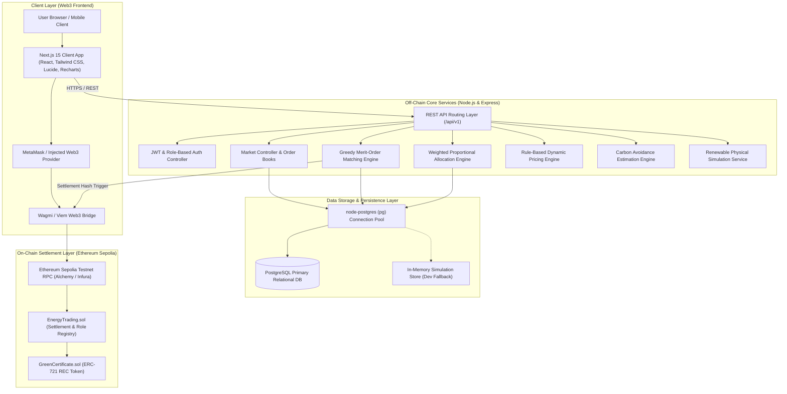
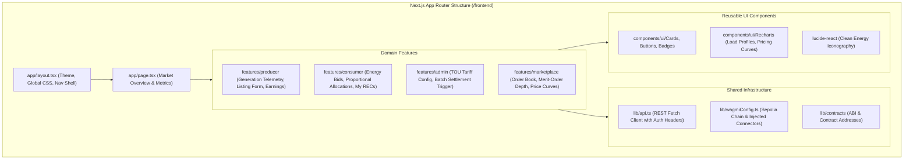
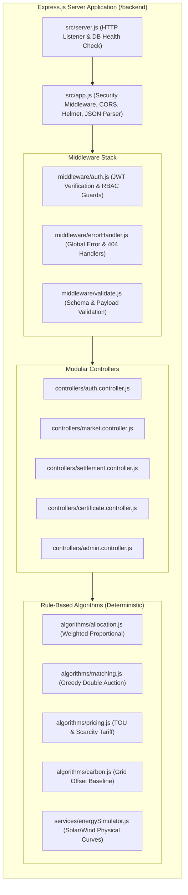
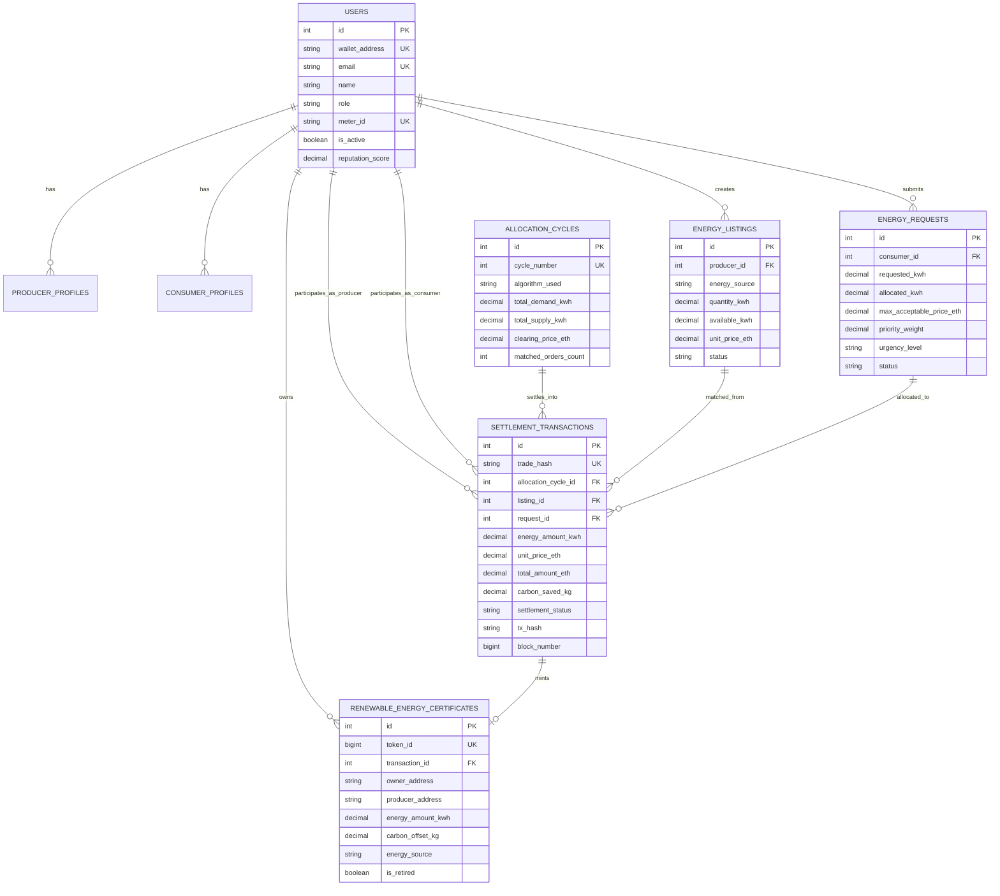
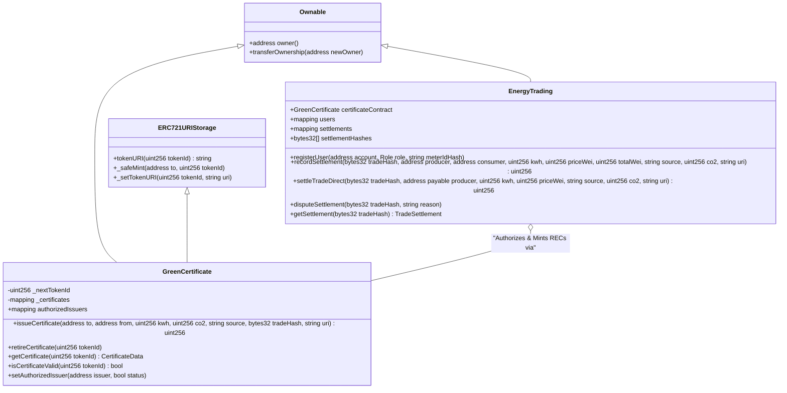
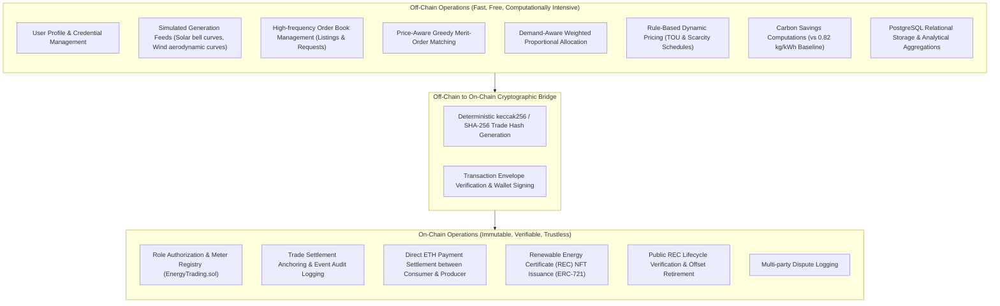
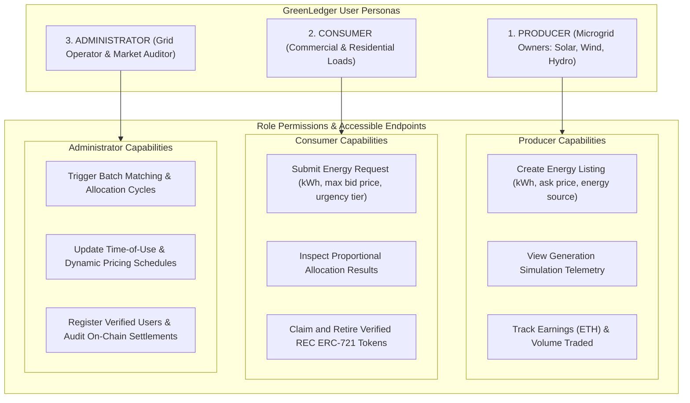
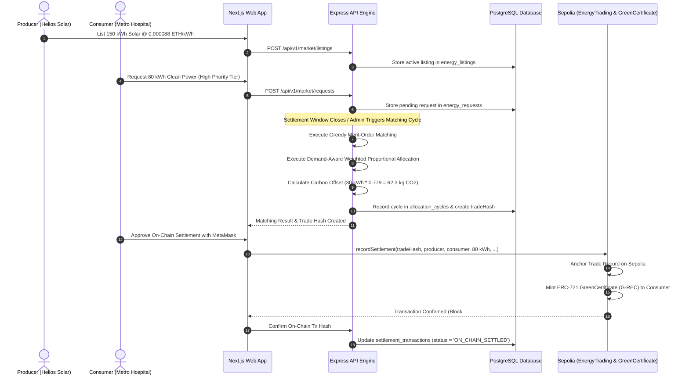

# GreenLedger System Architecture Documentation

## 1. Executive Summary

**GreenLedger** is a decentralized, software-simulated peer-to-peer (P2P) renewable energy trading platform that combines microgrid peer trading, demand-aware weighted proportional energy allocation, price-aware greedy merit-order matching, rule-based dynamic pricing, on-chain Ethereum Sepolia transaction settlement, and ERC-721 Renewable Energy Certificate (REC) verification.

To ensure deterministic reliability, platform verifiability, and regulatory auditability, GreenLedger strictly eliminates opaque machine learning, deep learning, and hardware/IoT dependencies. All telemetry is generated via physical simulation models, and clearing is handled via deterministic mathematics.

---

## 2. Overall System Architecture Diagram

---

## 3. Frontend Architecture

---

## 4. Backend Architecture

---

## 5. Database Architecture

---

## 6. Blockchain Architecture

---

## 7. On-Chain versus Off-Chain Responsibility Matrix

---

## 8. User Roles & Permission Matrix

---

## 9. End-to-End Data Flow Diagram

---

## 10. Proposed API Module Structure

```mermaid
classDiagram
    class API_V1 {
        +Base: /api/v1
    }

    class HealthRoutes {
        +GET /health : Returns uptime, DB connectivity, and Sepolia contracts
    }

    class AuthRoutes {
        +POST /auth/wallet : Web3 Wallet address nonce / JWT authentication
        +GET /auth/me : Returns authenticated user profile and roles
    }

    class MarketRoutes {
        +GET /market/listings : Query active energy listings (filter by source, price)
        +POST /market/listings : Producer creates new energy listing
        +GET /market/requests : Query active consumer energy requests
        +POST /market/requests : Consumer submits new energy request
        +GET /market/pricing/quote : Rule-based dynamic price quotation
        +GET /market/simulation/feed : Real-time mathematical simulation feed
    }

    class SettlementRoutes {
        +POST /settlement/match : Triggers greedy merit-order double auction
        +GET /settlement/history : Retrieve historical settlement records
    }

    class CertificateRoutes {
        +GET /certificates : List verified REC tokens
        +GET /certificates/verify/:tokenId : Check on-chain REC validity & metadata
        +GET /certificates/calculate-offsets : Estimate carbon savings for volume
    }

    class AdminRoutes {
        +GET /admin/users : Manage registered users
        +GET /admin/pricing-parameters : Retrieve global tariff parameters
        +GET /admin/stats : Platform aggregate KPIs and microgrid telemetry
    }

    API_V1 --> HealthRoutes
    API_V1 --> AuthRoutes
    API_V1 --> MarketRoutes
    API_V1 --> SettlementRoutes
    API_V1 --> CertificateRoutes
    API_V1 --> AdminRoutes
```

---

## 11. Cloud Architecture & AWS Budget Management (<100 Credits)

To adhere strictly to the budget constraint (~100 AWS credits), GreenLedger avoids expensive always-on resources like Hyperledger Fabric, AWS Managed Blockchain, multi-AZ enterprise RDS, or provisioned EKS clusters.

### Cost-Optimized AWS Strategy:
1. **Frontend**: Deployed via **AWS Amplify** (Free Tier eligible; pennies per build and GB transferred).
2. **Backend**: Containerized in a lightweight single **AWS Lambda** instance behind **API Gateway** (Pay-per-request, with millions of free tier invocations) or a modest **t4g.nano/micro** EC2 instance.
3. **Database**: **Amazon RDS PostgreSQL (db.t4g.micro single-AZ)** covered under the AWS 12-Month Free Tier (750 hours/month free).
4. **Static Storage / REC IPFS Metadata Mirror**: **Amazon S3 Standard** (Pennies for megabytes of REC metadata JSON and frontend assets).
5. **Observability**: **Amazon CloudWatch** set to basic 5-minute metrics with strict billing alarm triggers set at **$25, $50, and $75**.
