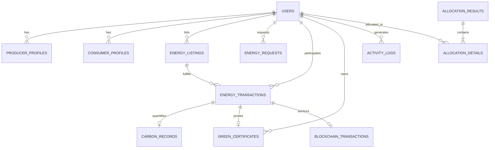

# GreenLedger Database Architecture & Design (Phase 4 Edition)

## 1. Relational Database Overview

GreenLedger utilizes a normalized PostgreSQL database designed for high transactional consistency, precise numerical accounting, auditability, and on-chain cryptographic settlement linkage.

- **Engine**: PostgreSQL 16+ (with active in-memory dual-mode fallback repository for development and sandbox testing)
- **Precision Standard**: All monetary values and energy volumes use `NUMERIC` types rather than floating-point to prevent IEEE 754 precision drift.
- **Concurrency & Integrity**: Energy purchase settlements use explicit database transactions with row-level locks (`SELECT ... FOR UPDATE`) to eliminate race conditions and overselling.

---

## 2. Entity-Relationship Model (12 Core Tables)

---

## 3. Detailed Table Specifications

### 3.1. `users`
Core user authentication and smart meter registry.
- `id`: `SERIAL PRIMARY KEY`
- `full_name`: `VARCHAR(120) NOT NULL`
- `email`: `VARCHAR(255) UNIQUE NOT NULL`
- `password_hash`: `VARCHAR(255) NOT NULL` (bcrypt 10-round salt)
- `role`: `VARCHAR(20) NOT NULL CHECK (role IN ('PRODUCER', 'CONSUMER', 'ADMIN'))`
- `wallet_address`: `VARCHAR(42) UNIQUE` (Ethereum Sepolia address)
- `meter_id`: `VARCHAR(100) UNIQUE NOT NULL` (Simulated smart meter ID)
- `account_status`: `VARCHAR(20) DEFAULT 'ACTIVE' CHECK (account_status IN ('ACTIVE', 'SUSPENDED', 'PENDING'))`
- `nonce`: `VARCHAR(100)` (Web3 cryptographic challenge)
- `phone`: `VARCHAR(30)`
- `reputation_score`: `NUMERIC(5, 2) DEFAULT 100.00`
- `created_at`: `TIMESTAMP WITH TIME ZONE DEFAULT CURRENT_TIMESTAMP`
- `updated_at`: `TIMESTAMP WITH TIME ZONE DEFAULT CURRENT_TIMESTAMP`

### 3.2. `energy_listings`
Renewable energy capacity offered by producers.
- `id`: `SERIAL PRIMARY KEY`
- `producer_id`: `INT NOT NULL REFERENCES users(id) ON DELETE RESTRICT`
- `energy_source`: `VARCHAR(30) NOT NULL CHECK (energy_source IN ('SOLAR', 'WIND', 'HYDRO', 'BIOMASS', 'HYBRID'))`
- `total_energy_kwh`: `NUMERIC(12, 2) NOT NULL CHECK (total_energy_kwh > 0)`
- `available_energy_kwh`: `NUMERIC(12, 2) NOT NULL CHECK (available_energy_kwh >= 0 AND available_energy_kwh <= total_energy_kwh)`
- `price_per_kwh`: `NUMERIC(16, 8) NOT NULL CHECK (price_per_kwh > 0)`
- `listing_status`: `VARCHAR(20) DEFAULT 'ACTIVE' CHECK (listing_status IN ('ACTIVE', 'PARTIALLY_FILLED', 'FILLED', 'CANCELLED', 'EXPIRED'))`
- `min_purchase_kwh`: `NUMERIC(10, 2) DEFAULT 1.00`
- `listing_window_start`: `TIMESTAMP WITH TIME ZONE DEFAULT CURRENT_TIMESTAMP`
- `listing_window_end`: `TIMESTAMP WITH TIME ZONE DEFAULT (CURRENT_TIMESTAMP + INTERVAL '24 hours')`
- `created_at`: `TIMESTAMP WITH TIME ZONE DEFAULT CURRENT_TIMESTAMP`
- `updated_at`: `TIMESTAMP WITH TIME ZONE DEFAULT CURRENT_TIMESTAMP`

### 3.3. `energy_requests`
Demand bids submitted by consumers.
- `id`: `SERIAL PRIMARY KEY`
- `consumer_id`: `INT NOT NULL REFERENCES users(id) ON DELETE RESTRICT`
- `requested_energy_kwh`: `NUMERIC(12, 2) NOT NULL CHECK (requested_energy_kwh > 0)`
- `priority_weight`: `NUMERIC(5, 2) DEFAULT 1.00 CHECK (priority_weight >= 1.0)`
- `request_status`: `VARCHAR(20) DEFAULT 'PENDING' CHECK (request_status IN ('PENDING', 'MATCHED', 'PARTIALLY_MATCHED', 'FULFILLED', 'CANCELLED', 'REJECTED', 'EXPIRED'))`
- `max_acceptable_price`: `NUMERIC(16, 8)`
- `urgency_level`: `VARCHAR(20) DEFAULT 'NORMAL' CHECK (urgency_level IN ('HIGH', 'NORMAL', 'FLEXIBLE'))`
- `created_at`: `TIMESTAMP WITH TIME ZONE DEFAULT CURRENT_TIMESTAMP`

### 3.4. `allocation_results`
High-level summary of algorithmic market clearing cycles.
- `id`: `SERIAL PRIMARY KEY`
- `total_available_energy`: `NUMERIC(14, 2) NOT NULL`
- `total_requested_energy`: `NUMERIC(14, 2) NOT NULL`
- `total_allocated_energy`: `NUMERIC(14, 2) NOT NULL`
- `algorithm_name`: `VARCHAR(50) NOT NULL`
- `jain_fairness_index`: `NUMERIC(6, 4)`
- `execution_time_ms`: `NUMERIC(10, 2)`
- `created_at`: `TIMESTAMP WITH TIME ZONE DEFAULT CURRENT_TIMESTAMP`

### 3.5. `allocation_details`
Itemized consumer fulfillment per clearing cycle.
- `id`: `SERIAL PRIMARY KEY`
- `allocation_result_id`: `INT NOT NULL REFERENCES allocation_results(id) ON DELETE CASCADE`
- `consumer_id`: `INT NOT NULL REFERENCES users(id) ON DELETE RESTRICT`
- `requested_energy_kwh`: `NUMERIC(12, 2) NOT NULL`
- `allocated_energy_kwh`: `NUMERIC(12, 2) NOT NULL`
- `unfulfilled_energy_kwh`: `NUMERIC(12, 2) NOT NULL`
- `fulfillment_ratio`: `NUMERIC(5, 4) NOT NULL`

### 3.6. `pricing_history`
Audit records of dynamic rule-based pricing computations.
- `id`: `SERIAL PRIMARY KEY`
- `base_price`: `NUMERIC(16, 8) NOT NULL`
- `supply_quantity`: `NUMERIC(14, 2) NOT NULL`
- `demand_quantity`: `NUMERIC(14, 2) NOT NULL`
- `supply_demand_ratio`: `NUMERIC(8, 4) NOT NULL`
- `calculated_price`: `NUMERIC(16, 8) NOT NULL`
- `minimum_price`: `NUMERIC(16, 8) NOT NULL`
- `maximum_price`: `NUMERIC(16, 8) NOT NULL`
- `created_at`: `TIMESTAMP WITH TIME ZONE DEFAULT CURRENT_TIMESTAMP`

### 3.7. `energy_transactions`
ACID-settled P2P energy trades.
- `id`: `SERIAL PRIMARY KEY`
- `producer_id`: `INT NOT NULL REFERENCES users(id) ON DELETE RESTRICT`
- `consumer_id`: `INT NOT NULL REFERENCES users(id) ON DELETE RESTRICT`
- `listing_id`: `INT REFERENCES energy_listings(id) ON DELETE SET NULL`
- `energy_quantity_kwh`: `NUMERIC(12, 2) NOT NULL CHECK (energy_quantity_kwh > 0)`
- `price_per_kwh`: `NUMERIC(16, 8) NOT NULL CHECK (price_per_kwh > 0)`
- `total_amount`: `NUMERIC(18, 8) NOT NULL CHECK (total_amount > 0)`
- `transaction_status`: `VARCHAR(20) DEFAULT 'PENDING' CHECK (transaction_status IN ('PENDING', 'CONFIRMED', 'SETTLED', 'FAILED', 'DISPUTED'))`
- `blockchain_transaction_hash`: `VARCHAR(66)`
- `created_at`: `TIMESTAMP WITH TIME ZONE DEFAULT CURRENT_TIMESTAMP`

### 3.8. `carbon_records`
Automated avoided emission offsets.
- `id`: `SERIAL PRIMARY KEY`
- `transaction_id`: `INT REFERENCES energy_transactions(id) ON DELETE SET NULL`
- `renewable_energy_kwh`: `NUMERIC(12, 2) NOT NULL`
- `grid_emission_factor`: `NUMERIC(6, 4) NOT NULL DEFAULT 0.8200` (0.8200 kg CO2 / kWh regional baseline)
- `estimated_carbon_savings`: `NUMERIC(12, 2) NOT NULL`
- `created_at`: `TIMESTAMP WITH TIME ZONE DEFAULT CURRENT_TIMESTAMP`

### 3.9. `green_certificates`
ERC-721 tokenized Renewable Energy Certificates (GL-REC).
- `id`: `SERIAL PRIMARY KEY`
- `transaction_id`: `INT REFERENCES energy_transactions(id) ON DELETE SET NULL`
- `certificate_number`: `VARCHAR(100) UNIQUE NOT NULL`
- `owner_id`: `INT NOT NULL REFERENCES users(id) ON DELETE RESTRICT`
- `energy_quantity_kwh`: `NUMERIC(12, 2) NOT NULL`
- `carbon_savings`: `NUMERIC(12, 2) NOT NULL`
- `blockchain_certificate_id`: `BIGINT UNIQUE`
- `blockchain_transaction_hash`: `VARCHAR(66)`
- `certificate_status`: `VARCHAR(20) DEFAULT 'ISSUED' CHECK (certificate_status IN ('PENDING', 'ISSUED', 'RETIRED', 'TRANSFERRED'))`
- `created_at`: `TIMESTAMP WITH TIME ZONE DEFAULT CURRENT_TIMESTAMP`

### 3.10. `blockchain_transactions`
On-chain settlement receipts on Ethereum Sepolia.
- `id`: `SERIAL PRIMARY KEY`
- `application_transaction_id`: `INT REFERENCES energy_transactions(id) ON DELETE SET NULL`
- `transaction_hash`: `VARCHAR(66) UNIQUE NOT NULL`
- `contract_address`: `VARCHAR(42) NOT NULL`
- `network_name`: `VARCHAR(50) DEFAULT 'Sepolia'`
- `transaction_type`: `VARCHAR(50) NOT NULL CHECK (transaction_type IN ('SETTLEMENT', 'REC_MINT', 'REC_TRANSFER', 'REC_RETIRE'))`
- `transaction_status`: `VARCHAR(20) DEFAULT 'CONFIRMED' CHECK (transaction_status IN ('PENDING', 'CONFIRMED', 'FAILED'))`
- `block_number`: `BIGINT`
- `created_at`: `TIMESTAMP WITH TIME ZONE DEFAULT CURRENT_TIMESTAMP`

### 3.11. `platform_settings`
Global configurable governance parameters.
- `id`: `SERIAL PRIMARY KEY`
- `setting_key`: `VARCHAR(100) UNIQUE NOT NULL`
- `setting_value`: `TEXT NOT NULL`
- `updated_at`: `TIMESTAMP WITH TIME ZONE DEFAULT CURRENT_TIMESTAMP`

### 3.12. `activity_logs`
System security and audit trail.
- `id`: `SERIAL PRIMARY KEY`
- `user_id`: `INT REFERENCES users(id) ON DELETE SET NULL`
- `action`: `VARCHAR(100) NOT NULL`
- `description`: `TEXT`
- `created_at`: `TIMESTAMP WITH TIME ZONE DEFAULT CURRENT_TIMESTAMP`
